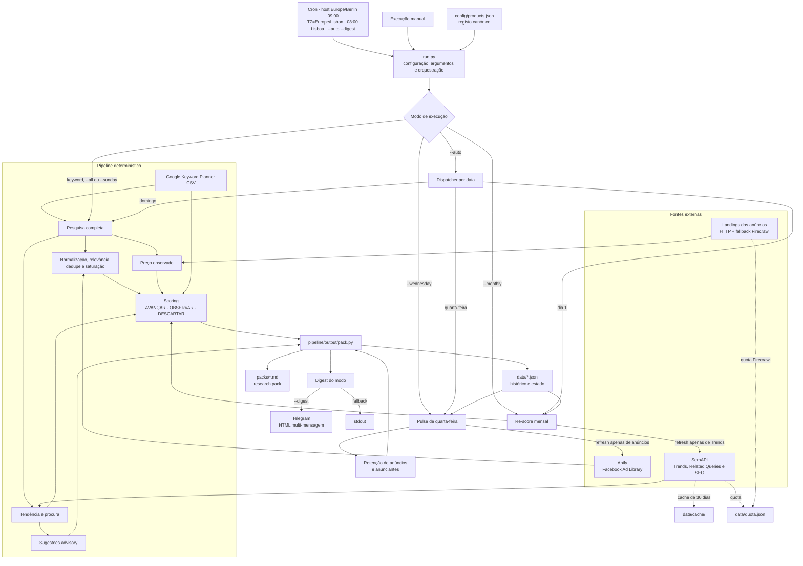

# ECOM-RESEARCH

CLI determinístico para transformar cada combinação `produto × mercado × keyword local × período` num research pack. O score e as recomendações são sempre locais (`AVANÇAR PT`, `AVANÇAR GB`); recolhas globais ficam reservadas a descoberta e nunca entram num score de mercado.

## Setup

```bash
python3 -m venv .venv
source .venv/bin/activate
pip install -r requirements.txt
cp .env.example .env
```

O modo full requer `APIFY_API_TOKEN` e `SERPAPI_KEY`. O repositório não contém credenciais Telegram localmente e o `.env` está ignorado pelo Git. Não alteres `config/keywords.txt` para aceitar sugestões: elas aparecem no pack e no digest com `status: proposed`.

- `APIFY_API_TOKEN`: token do Apify para `curious_coder~facebook-ads-library-scraper`.
- `SERPAPI_KEY`: Trends e snapshot SEO.
- `FIRECRAWL_KEY`: fallback opcional para landings sem preço no HTML.
- `TELEGRAM_BOT_TOKEN` e `TELEGRAM_CHAT_ID`: entrega opcional, sempre send-only.
- `TELEGRAM_RENDERER=html`: renderer do outbound (default de código e documentado; Rich permanece desativado para a coorte de clientes atual).

O registo canónico de produtos é `config/products.json` (`schema_version=1`): cinco produtos com `product_id` imutável e aliases históricos. `config/markets.json` define PT e GB, incluindo moeda e os parâmetros locais de Ads, Trends e SERP. A matriz inicial é PT para os cinco produtos e GB apenas para velas, onde o alias português resolve para `scented candles` sem mudar o `product_id`. `config/keywords.txt` permanece histórico e não é lido em runtime.

O volume e CPC vêm de exports manuais do Google Keyword Planner em `data/`. Cada `<ficheiro>.csv` precisa de um sidecar `<ficheiro>.csv.meta.json` com `{"market_id":"PT","currency":"EUR"}` ou `{"market_id":"GB","currency":"GBP"}`. O parser liga a keyword à linha exata e falha fechado se o sidecar estiver ausente ou não corresponder ao target. Sem `--csv`, o runner escolhe o export mais recente compatível com cada mercado; sem prova compatível, o resultado fica `DADOS INSUFICIENTES`.

## Uso

```bash
.venv/bin/python run.py "mochila personalizada" --market PT
.venv/bin/python run.py "velas" --market GB
.venv/bin/python run.py --all
.venv/bin/python run.py --sunday
.venv/bin/python run.py --wednesday
.venv/bin/python run.py --monthly
.venv/bin/python run.py --auto --digest
```

`--sunday` e `--all` percorrem a matriz configurada em `config/products.json` + `config/markets.json`: PT para os cinco produtos e GB para velas. O token posicional resolve por `product_id`, nome, `research_keyword` ou alias e `--market` escolhe o target (PT por omissão). Um token/mercado desconhecido falha antes de qualquer chamada externa. `--auto` usa a mesma matriz num único cron: dia 1 primeiro, depois domingo ou quarta quando aplicável.

A precedência de selectores é fixa: `auto > sunday > wednesday > monthly > all > keyword`, com `--digest` ortogonal. Selectores sombreados (ex.: `--sunday --monthly`) geram avisos determinísticos no stderr, sem transformar comandos legados em erros. `--csv` com um caminho inexistente é erro fatal apenas nos modos que consomem CSV (keyword, `--all`, `--sunday`, e `--auto` quando dispara o domingo); nos restantes é ignorado com aviso.

## Arquitetura



`run.py` é o único orquestrador. O modo completo recolhe todos os sinais; quarta-feira reutiliza o último pack e atualiza apenas anúncios; o mensal reutiliza o último `OBSERVAR` e força apenas Trends. O JSON produzido funciona simultaneamente como output e estado histórico para os modos incrementais.

## Idempotência e proveniência

Cada ação lógica (domingo, quarta, dia 1, `--all`, keyword) tem um `run_id` determinístico derivado de data + modo + descritores ordenados `(product_id, market_id, research_keyword)` + versões de scoring/matcher — sem credenciais, relógio ou `--digest`. Mudar a query ativa de um produto (novo `research_keyword` no mesmo `product_id`) cria um run novo; uma alteração só de nome ou de aliases não participa na identidade e o histórico mantém-se. O fingerprint dos CSV e sidecars selecionados para cada target participa da identidade apenas nas ações que os consomem (keyword, `--all`, `--sunday` — incluindo domingo via `--auto`), para que uma alteração PT/GB nunca reutilize um manifesto stale e quarta/mensal permaneçam estáveis quando exports não relacionados mudam. Um run concluído reutiliza o digest e os artefactos persistidos em `data/runs/` sem voltar a gastar fontes pagas. `--auto` e a invocação direta do mesmo modo partilham a mesma identidade de run. Um run feito sem `--digest` permite um `--digest` posterior sem rerun de pesquisa.

Domingo e `--all` gravam o manifesto atomicamente após cada keyword (checkpoint por keyword). Um rerun de um manifesto `running`/`failed`/`completed_with_errors` reutiliza os resultados terminais (zero chamadas pagas para keywords já bem-sucedidas) e repete apenas as keywords com falha técnica ou ausentes do checkpoint. Um run só fica `completed` quando todas as keywords atingem um desfecho intencional; uma exceção técnica (não uma falha de fonte esperada) deixa o run `completed_with_errors`. Nesse caso o digest parcial nunca vai para o Telegram — o conteúdo mudaria após o retry e o operador receberia dois digests diferentes: é impresso no stdout e persistido com `delivery.status == "deferred"`, e o digest final é entregue exatamente uma vez depois de as keywords falhadas conseguirem. Falhas de fonte esperadas (Apify offline → pack `DADOS INSUFICIENTES`; quarta/mensal preservado) continuam terminais e digestáveis. Exactly-once ao nível da fonte não é garantido entre crashes (janela entre a chamada paga e a escrita do manifesto).

Os locks de run (um por `run_id`) e de quota (`data/quota.json.lock`) são bloqueantes e fail-closed: um segundo processo bloqueia até o primeiro terminar e o código nunca prossegue sem lock (fcntl indisponível ou lock inutilizável → erro). Tradeoff operacional aceite: o lock de quota é segurado durante a chamada ao provider inteira, o que serializa pedidos entre processos — risco residual de latência/concorrência — em troca de limites duros e contabilidade atómicos entre processos.

O JSON do pack ganha metadados aditivos: `run_id`, `mode`, `market_id`, o snapshot `market`, `market_signals`, `generated_at`/`completed_at`, `scoring_version`, `scoring_config`, `source_states` e `source_policies`. As chaves antigas (`keyword`, `date`, `score`, `trends`, `keyword_planner`, `facebook_ads`, `seo`, `suggested_keywords`, `ad_cohort`) permanecem como aliases. O Markdown ganha uma secção concisa **Proveniência** sem alterar o conteúdo das recomendações. Os estados de fonte são `valid` (um zero-ads Apify conta como leitura válida, e um run zero-ads regista Trends como `related_queries_only` mesmo quando a lista vem vazia), `stale` (evidência reutilizada de quarta/mensal), `missing` (não aplicável ou não tentado) e `failed` (erro de request/parse). As políticas de fonte (TTL, quota, timeout, retries=0, fallback) são persistidas sem segredos.

No dia 1, se o Trends falhar para uma keyword, o pack anterior é preservado: não é escrito nenhum pack de substituição, a falha aparece no digest e no run state, e a keyword permanece na watchlist OBSERVAR. A timeseries do Trends usa timeout de 60s, refletido na política de proveniência; payloads de erro nunca são cacheados e entradas de erro legadas são tratadas como miss e removidas.

## Facebook Ad Library via Apify

Cada target faz uma única chamada POST, com custo limitado a uma invocação e sample de 100. A URL da Ad Library usa `country=PT` ou `country=GB` e `is_targeted_country=true`; `country=ALL` permanece disponível apenas para descoberta global fora do scoring local. Não há retries.

A resposta é normalizada localmente com o adapter como limitador de fonte: status inativo é removido, texto é accent-folded e o gate 1 exige apenas o token product-head da keyword (primeiro token que não é stopword nem qualificador geográfico, com equivalência exacta ou plural de um só `s` final) em qualquer parte do copy/texto do anunciante — menções genéricas (uma mochila escolar para `mochila personalizada`) continuam candidatas e é o matcher que decide forte vs ambíguo vs rejeitado; ruído só-geográfico sem o head cai aqui. Duplicados são removidos por `ad_archive_id`, depois URL, depois `page_id + copy + date`. Todo anúncio ativo, gate-1-relevante e deduplicado torna-se um **candidato canónico persistido** (máx. 100) com uma shape pequena de `match_evidence` (texto forte commercial/geo e fraco weak, folded, sem URLs cruas). O adapter nunca decide se um anúncio pertence ao produto: a classificação (`matched` / `needs_review` / `rejected`) vive em `pipeline/matching/product_ads.py`, que exige o product-head e todos os tokens significativos (incluindo modificadores como `personalizada`/`aromáticas`) em campos comerciais fortes e os qualificadores geográficos em campos geo-proof estritos; prova parcial produz `needs_review` e ausência do head produz `rejected`.

O resultado classificado deriva `top_ads`, `ad_ids`, `advertisers`, `copy_examples`, `saturation` e `global_market_proven` **apenas dos candidatos `matched`**; `total_ads` é a contagem matched. O pack guarda as contagens completas (raw, inativos, irrelevantes gate-1, candidatos, duplicados, matched, needs_review, rejected), `matcher_version` e `matching_schema_version`.

Um resultado local vazio (zero candidatos) pode produzir `DESCARTAR`, sem SEO nem landing, e ainda faz uma call Related Queries local. Se Ads, Trends, SERP ou Keyword Planner não provarem a geografia/moeda esperada, o gate geográfico sobrepõe qualquer decisão e produz `DADOS INSUFICIENTES`. Zero matched com qualquer candidato `needs_review` produz `DADOS INSUFICIENTES` (evidência ambígua, sem decisão negativa); zero matched com todos rejeitados produz `DESCARTAR`. Uma falha do Apify continua Trends, SEO e CSV, mas produz `DADOS INSUFICIENTES` e nunca um `DESCARTAR` falso.

## Custos e modos

| Modo | Apify | SerpAPI | SEO/landing | Dados usados |
|---|---:|---:|---|---|
| Full / domingo | 1 por keyword | Timeseries + related, salvo cache | Ambos, exceto falha Apify ou zero ads | Fresh |
| Quarta | 1 chamada paga/bounded por keyword elegível | 0 | 0 | Trends, CSV, SEO, landing, sugestões e score anteriores |
| Dia 1 | 0 | 1 timeseries forçada por keyword | 0 | Ads, CSV, SEO, landing e sugestões anteriores |

A quarta compara `ad_ids` e advertisers (projeções matched-only), mas se o Apify falhar relata o erro e preserva o último pack bom. O mensal é um caminho de rescore separado: não faz refresh de anúncios nem chama Firecrawl. Tanto a quarta como o mensal **nunca re-score nem comparam coortes sobre um pack anterior sem `matching_schema_version`**: saltam fail-closed com razão explícita (zero calls pagas) e preservam o pack legado sem reescrever história. O `run_id` inclui `scoring_version` e `matcher_version`; o pack e o manifest persistem ambos.

## Sugestões e mercados

`pipeline/suggestions.py` normaliza resultados Related Queries numéricos e `Breakout`, ordena Breakout primeiro e depois valores numéricos descendentes, remove vazios, a keyword original, duplicados, URLs e interrogativas. O JSON guarda `suggested_keywords`; o Markdown usa a secção **Sugestões de keywords — aprovação manual** e declara que nada foi adicionado a `config/keywords.txt`.

Ads, Trends, SERP, caches e Keyword Planner são scoped ao mesmo `market_id`. Trends persiste slopes aproximados de 30 e 90 dias; `EMERGENTE` exige aceleração 30d ≥20%, 90d não negativa, related queries locais, pelo menos três anunciantes e confirmação numa segunda recolha. `DURÁVEL` exige retenção de anúncios ≥70% ou um anunciante observado há pelo menos 30 dias. Estes sinais são advisory e aparecem no pack/Telegram; não alteram a fórmula do score. Ranking automático de países, US e granularidade regional de Inglaterra continuam fora de scope.

## Landings e Telegram

Preços usam exclusivamente `top_ads[].landing_url`; links da Ad Library são rejeitados. A moeda é sempre derivada da fonte (`priceCurrency` ou símbolo/código explícito), nunca é assumida sem evidência, e preços de moedas diferentes nunca são combinados num range. São tentadas no máximo três landings, primeiro por HTTP e depois por Firecrawl, com falhas isoladas e sem retries. Quarta e mensal reutilizam o resultado anterior.

Telegram é send-only e determinístico: o outbound é HTML multi-mensagem por omissão (`TELEGRAM_RENDERER=html`, default de código e documentado em `.env.example`). `keyword` envia uma mensagem de produto; `sunday`/`all` enviam resumo seguido de uma mensagem por produto; `wednesday` envia resumo pulse seguido de itens compactos; `monthly` envia resumo seguido dos produtos afetados. Rich está implementado mas desativado. O fallback Rich→HTML é baseado em evidência: um classificador estreito (4xx definitivo consistente + token simbólico exato da allowlist ou descrição completa normalizada exata) tenta no máximo uma vez, e um item que caiba nos 32768 caracteres Rich mas não nos 4096 do HTML falha fechado (`render_failed`) sem truncar. O diagnóstico da duplicação visual do smoke concluiu que não há double-send: o estado retido (`/tmp/ecom-telegram-smoke-state`) prova dois itens Rich enviados uma única vez (`message_id` 17/18 consecutivos), o retry fez zero chamadas de rede, a inspeção offline encontrou um `sendRichMessage` por item, sem campo de texto irmão nem conteúdo duplicado, e as mesmas mensagens 17/18 aparecem uma única vez num segundo cliente Telegram — a duplicação é específica do cliente que a exibiu, não da aplicação. Sem correção de produção justificada, `TELEGRAM_RENDERER=html` mantém-se e Rich fica desativado para a coorte de clientes atual. Não existem callbacks, botões, media nem long polling. O digest plain text integral é impresso no stdout e guardado como audit text no estado de entrega. Falta de credenciais ou qualquer erro não interrompe o pipeline; o token nunca é escrito em logs; o token Telegram exposto deve ainda ser rotacionado pelo utilizador.

O progresso de entrega é persistido em `data/digests/<state_id>.json` com `schema_version=2` e estado por item: `item_id`, ordem, renderer durável, hash do payload, `in_flight`, `sent_at`, `message_id`, fallback e erro sanitizado, mais o audit text do digest. Antes de cada envio, o marcador `in_flight` é escrito atomicamente; se a persistência falhar, nada é enviado. Um item só fica `sent` depois de `ok=true` com resposta válida e `message_id` guardado; timeout, transporte, 5xx, JSON ilegível ou resposta malformada deixam o item ambíguo e qualquer rerun recusa reenviar até resolução manual, evitando duplicações automáticas. Itens confirmados nunca são reenviados; estados ilegíveis ou inconsistentes falham fechado (`state_corrupt`). O renderer de um batch já persistido é deliberadamente durável e não muda com a variável de ambiente. O token e o chat ID nunca são persistidos.

## Saída

- `packs/YYYY-MM-DD--<modo>--<id12>--<market>--<keyword>--<run_id[:12]>.md` / `data/YYYY-MM-DD--<modo>--<id12>--<market>--<keyword>--<run_id[:12]>.json`: todos os packs atuais são run-scoped e separados por mercado — o nome inclui o modo (keyword/all/sunday/wednesday/monthly), um id estável de 12 hex (o `product_id` canónico quando presente, que sobrevive a renomeações da query; o hash da keyword fica apenas como fallback para chamadores legados) e o prefixo do `run_id` (o mesmo run repetido resolve para o mesmo caminho). Os packs novos carregam `product_id`/`market_id`/`product_name`/`research_keyword`; `keyword` continua a ser a query local real. Ex.: `2026-08-09--sunday--258053734570--gb--scented-candles--abc123def456`.
- Nomes legados `YYYY-MM-DD--<keyword>.md` / `.json` (e `--wednesday`/`--monthly`) continuam a ser lidos pelos selectors (compatibilidade read-only), mas já não são escritos.
- `data/runs/<run_id>.json`: manifesto de cada ação lógica (idempotência, checkpoints por keyword e estado de entrega do digest).
- `data/digests/<state_id>.json`: estado de entrega v2 por item (`schema_version=2`), com audit text e `message_id` por mensagem.
- `data/cache/`: cache de Trends/SEO/Related Queries por `market_id + keyword` durante 30 dias (payloads de erro nunca são cacheados; entradas corrompidas ou inválidas são miss).
- `data/quota.json`: contador SerpAPI e créditos Firecrawl (escritas atómicas).

As recomendações são operacionais e específicas por país: `AVANÇAR GB` prepara validação comercial desse mercado, `OBSERVAR PT` mantém a watchlist local, `DESCARTAR <mercado>` arquiva salvo nova evidência e `DADOS INSUFICIENTES <mercado>` pede correção/retry das fontes.

## Explorer SQLite (projeção read-only)

Os packs JSON continuam a ser a evidência canónica e **nunca são reescritos**. Uma projeção SQLite descartável e idempotente (`pipeline/projection/` + `explore.py`) importa apenas os packs completos classificados atuais — `run_id`/`product_id`/`market_id` top-level não vazios, `artifact_complete=true`, data e score label válidos, `facebook_ads.matching_schema_version` igual ao `MATCHING_SCHEMA_VERSION` atual e candidatos classificados presentes. Chave por `(run_id, product_id, market_id)`, com fingerprint SHA-256 do JSON canónico completo do pack: reimportar conteúdo idêntico é no-op e a mesma identidade com conteúdo diferente falha com erro de conflito específico, sem alterar linhas. Cada pack é importado com a linha e todos os candidatos numa única transação, foreign keys ativas e schema version 2 fixada via `PRAGMA user_version`; uma base incompatível falha fechado se divergir em tipos/afinidades, `NOT NULL`, chaves ou `ON DELETE CASCADE`, por isso deve ser apagada e reimportada.

```bash
.venv/bin/python explore.py import [--db data/ecom_research.db] [--data-dir data]
.venv/bin/python explore.py serve [--db data/ecom_research.db] [--host 127.0.0.1] [--port 8001]
```

`import` descobre `data/*.json` deterministicamente: packs legados válidos (sem `matching_schema_version`) e ficheiros não-pack (ex.: `data/quota.json`) são saltados read-only e reportados com razão; JSON malformado ou um pack que reivindica a schema atual mas viola a shape exigida falha fechado com erro acionável. Números projetados têm de caber no integer signed 64-bit do SQLite quando aplicável, e erros de shape identificam campo/posição/tipo sem ecoar valores crus do pack. `serve` abre a base em `mode=ro`, recusa uma base ausente ou incompatível e lança Datasette com `--immutable`, queries read-only prontas (últimos packs, candidatos `needs_review`, anunciantes matched) e bind a localhost por omissão.

**Comportamento sem packs classificados atuais:** se `data/` contiver apenas packs legados ou ficheiros auxiliares, `import` cria uma projeção válida vazia, reporta os skips read-only e termina com exit 0. Quando existirem packs com `matching_schema_version` atual e candidatos classificados, estes são importados normalmente.

## Verificação

```bash
.venv/bin/python -m pytest tests/ -q
.venv/bin/python -m compileall run.py pipeline explore.py
.venv/bin/python run.py --help
git diff --check
```

Todos os testes mockam rede; não são feitas chamadas reais durante a verificação. A suite completa fica verde em cada checkpoint (os números exatos de testes mudam com o contrato e não são referenciados aqui).

## Estado live

O smoke live de uma keyword e uma entrega de um digest Telegram foram concluídos com sucesso. O smoke autorizado do outbound multi-mensagem correu no chat de teste: HTML aprovado (exatamente duas mensagens, retry com zero chamadas de rede); Rich aceite pela API mas desativado — a duplicação visual foi diagnosticada como específica do cliente (as mensagens 17/18 aparecem uma única vez num segundo cliente Telegram), sem reenvio pela aplicação. O host atual usa `Europe/Berlin`; o serviço cron está ativo e habilitado (`active`/`enabled`) e existe exactamente um job. Com `TZ=Europe/Lisbon`, o job das 09:00 do host corresponde às 08:00 de Lisboa e executa `--auto --digest`:

```cron
TZ=Europe/Lisbon
0 9 * * * cd /home/vitor/projects/Ecom-Research && /home/vitor/projects/Ecom-Research/.venv/bin/python run.py --auto --digest >> /home/vitor/projects/Ecom-Research/data/cron.log 2>&1
```

O cron verifica a data diariamente, mas só atua ao domingo, à quarta-feira e no dia 1 do mês. O token Telegram exposto deve ainda ser rotacionado pelo utilizador.
