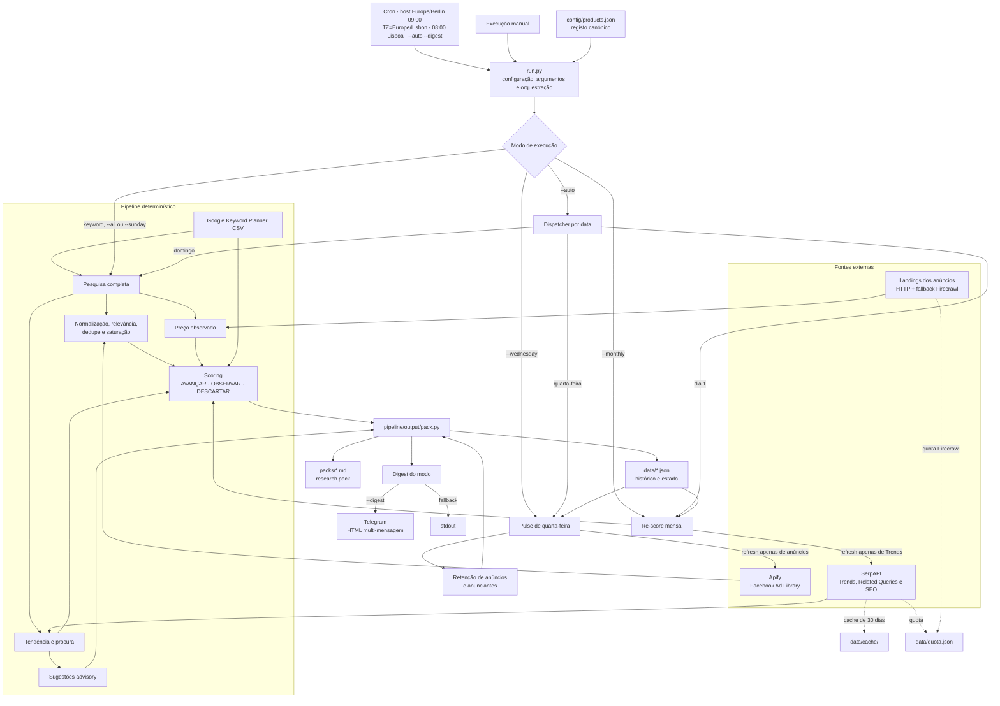

# ECOM-RESEARCH

CLI determinístico para transformar uma keyword num research pack. O pipeline usa anúncios ativos globais existentes como evidência de procura; o score organiza sinais, mas não escolhe produto, país ou campanha. Qualquer sugestão é advisory e precisa de aprovação manual.

## Setup

```bash
python3 -m venv .venv
source .venv/bin/activate
pip install -r requirements.txt
cp .env.example .env
```

O modo full requer `APIFY_API_TOKEN` e `SERPAPI_KEY`. O repositório não contém credenciais Telegram localmente e o `.env` está ignorado pelo Git. Não alteres `config/keywords.txt` para aceitar sugestões: elas aparecem no pack e no digest com `status: proposed`.

- `APIFY_API_TOKEN`: token do Apify para `curious_coder~facebook-ads-library-scraper`.
- `SERPAPI_KEY`: Trends e snapshot SEO.
- `FIRECRAWL_KEY`: fallback opcional para landings sem preço no HTML.
- `TELEGRAM_BOT_TOKEN` e `TELEGRAM_CHAT_ID`: entrega opcional, sempre send-only.
- `TELEGRAM_RENDERER=html`: renderer do outbound (default de código e documentado; Rich permanece desativado para a coorte de clientes atual).

O registo canónico de produtos é `config/products.json` (`schema_version=1`): seis produtos com `product_id` imutável (cinco ativos; `copper bottles` preservado inativo após o smoke live) (preservado do antigo hash de 12 hex da keyword), um `research_keyword` ativo por produto e aliases para keywords históricas (camisola portugal consolida camisolas portugal, camisola de portugal e camisola portugal preta). `config/keywords.txt` permanece intacto e já não é lido em runtime.

O volume e CPC vêm de um export manual do Google Keyword Planner colocado em `data/`. O parser aceita o formato real em UTF-16 LE com BOM, tabulação e preâmbulo de título/data, além do CSV UTF-8 legado, e liga cada keyword à sua linha de produto exacta após normalização. Sem CSV, o pipeline degrada graciosamente, mas o score perde esse sinal.

## Uso

```bash
.venv/bin/python run.py "mochila personalizada"
.venv/bin/python run.py --all
.venv/bin/python run.py --sunday
.venv/bin/python run.py --wednesday
.venv/bin/python run.py --monthly
.venv/bin/python run.py --auto --digest
```

`--sunday` e `--all` usam os produtos ativos de `config/products.json`; o token posicional resolve por `product_id`, nome, `research_keyword` ou alias — um token desconhecido sai com erro (exit 2) antes de qualquer chamada de fonte/rede, e um registo ausente ou inválido falha fechado. `--auto` executa todas as ações que coincidirem com a data: no dia 1 executa primeiro o re-score mensal; depois executa domingo ou quarta-feira quando aplicável. Cada ação produz o seu próprio digest.

A precedência de selectores é fixa: `auto > sunday > wednesday > monthly > all > keyword`, com `--digest` ortogonal. Selectores sombreados (ex.: `--sunday --monthly`) geram avisos determinísticos no stderr, sem transformar comandos legados em erros. `--csv` com um caminho inexistente é erro fatal apenas nos modos que consomem CSV (keyword, `--all`, `--sunday`, e `--auto` quando dispara o domingo); nos restantes é ignorado com aviso.

## Arquitetura



`run.py` é o único orquestrador. O modo completo recolhe todos os sinais; quarta-feira reutiliza o último pack e atualiza apenas anúncios; o mensal reutiliza o último `OBSERVAR` e força apenas Trends. O JSON produzido funciona simultaneamente como output e estado histórico para os modos incrementais.

## Idempotência e proveniência

Cada ação lógica (domingo, quarta, dia 1, `--all`, keyword) tem um `run_id` determinístico derivado de data + modo + pares ordenados `(product_id, research_keyword)` + `SCORING_VERSION` — sem credenciais, relógio ou `--digest`. Mudar a query ativa de um produto (novo `research_keyword` no mesmo `product_id`) cria um run novo; uma alteração só de nome ou de aliases não participa na identidade e o histórico mantém-se. O hash do CSV participa da identidade apenas nas ações que consomem o CSV (keyword, `--all`, `--sunday` — incluindo domingo via `--auto`), para que quarta e mensal permaneçam estáveis quando ficheiros CSV não relacionados mudam. Um run concluído reutiliza o digest e os artefactos persistidos em `data/runs/` sem voltar a gastar fontes pagas. `--auto` e a invocação direta do mesmo modo partilham a mesma identidade de run. Um run feito sem `--digest` permite um `--digest` posterior sem rerun de pesquisa.

Domingo e `--all` gravam o manifesto atomicamente após cada keyword (checkpoint por keyword). Um rerun de um manifesto `running`/`failed`/`completed_with_errors` reutiliza os resultados terminais (zero chamadas pagas para keywords já bem-sucedidas) e repete apenas as keywords com falha técnica ou ausentes do checkpoint. Um run só fica `completed` quando todas as keywords atingem um desfecho intencional; uma exceção técnica (não uma falha de fonte esperada) deixa o run `completed_with_errors`. Nesse caso o digest parcial nunca vai para o Telegram — o conteúdo mudaria após o retry e o operador receberia dois digests diferentes: é impresso no stdout e persistido com `delivery.status == "deferred"`, e o digest final é entregue exatamente uma vez depois de as keywords falhadas conseguirem. Falhas de fonte esperadas (Apify offline → pack `DADOS INSUFICIENTES`; quarta/mensal preservado) continuam terminais e digestáveis. Exactly-once ao nível da fonte não é garantido entre crashes (janela entre a chamada paga e a escrita do manifesto).

Os locks de run (um por `run_id`) e de quota (`data/quota.json.lock`) são bloqueantes e fail-closed: um segundo processo bloqueia até o primeiro terminar e o código nunca prossegue sem lock (fcntl indisponível ou lock inutilizável → erro). Tradeoff operacional aceite: o lock de quota é segurado durante a chamada ao provider inteira, o que serializa pedidos entre processos — risco residual de latência/concorrência — em troca de limites duros e contabilidade atómicos entre processos.

O JSON do pack ganha metadados aditivos: `run_id`, `mode`, `generated_at`/`completed_at`, `scoring_version`, `scoring_config`, `source_states` e `source_policies`. As chaves antigas (`keyword`, `date`, `score`, `trends`, `keyword_planner`, `facebook_ads`, `seo`, `suggested_keywords`, `ad_cohort`) permanecem como aliases. O Markdown ganha uma secção concisa **Proveniência** sem alterar o conteúdo das recomendações. Os estados de fonte são `valid` (um zero-ads Apify conta como leitura válida, e um run zero-ads regista Trends como `related_queries_only` mesmo quando a lista vem vazia), `stale` (evidência reutilizada de quarta/mensal), `missing` (não aplicável ou não tentado) e `failed` (erro de request/parse). As políticas de fonte (TTL, quota, timeout, retries=0, fallback) são persistidas sem segredos.

No dia 1, se o Trends falhar para uma keyword, o pack anterior é preservado: não é escrito nenhum pack de substituição, a falha aparece no digest e no run state, e a keyword permanece na watchlist OBSERVAR. A timeseries do Trends usa timeout de 60s, refletido na política de proveniência; payloads de erro nunca são cacheados e entradas de erro legadas são tratadas como miss e removidas.

## Facebook Ad Library via Apify

Cada keyword faz uma única chamada POST, com custo do actor limitado a uma invocação e sample de 100, com timeout de conexão/leitura `(10, 135)`, `count=100` e uma URL global da Ad Library com `active_status=active`, `ad_type=all`, `country=ALL`, `is_targeted_country=false`, `media_type=all`, `search_type=keyword_unordered` e `q` URL-encoded. Não há retries.

A resposta é normalizada localmente com o adapter como limitador de fonte: status inativo é removido, texto é accent-folded e o gate 1 exige apenas o token product-head da keyword (primeiro token que não é stopword nem qualificador geográfico, com equivalência exacta ou plural de um só `s` final) em qualquer parte do copy/texto do anunciante — menções genéricas (uma mochila escolar para `mochila personalizada`) continuam candidatas e é o matcher que decide forte vs ambíguo vs rejeitado; ruído só-geográfico sem o head cai aqui. Duplicados são removidos por `ad_archive_id`, depois URL, depois `page_id + copy + date`. Todo anúncio ativo, gate-1-relevante e deduplicado torna-se um **candidato canónico persistido** (máx. 100) com uma shape pequena de `match_evidence` (texto forte commercial/geo e fraco weak, folded, sem URLs cruas). O adapter nunca decide se um anúncio pertence ao produto: a classificação (`matched` / `needs_review` / `rejected`) vive em `pipeline/matching/product_ads.py`, que exige o product-head e todos os tokens significativos (incluindo modificadores como `personalizada`/`aromáticas`) em campos comerciais fortes e os qualificadores geográficos em campos geo-proof estritos; prova parcial produz `needs_review` e ausência do head produz `rejected`.

O resultado classificado deriva `top_ads`, `ad_ids`, `advertisers`, `copy_examples`, `saturation` e `global_market_proven` **apenas dos candidatos `matched`**; `total_ads` é a contagem matched. O pack guarda as contagens completas (raw, inativos, irrelevantes gate-1, candidatos, duplicados, matched, needs_review, rejected), `matcher_version` e `matching_schema_version`.

Um resultado vazio (zero candidatos) é sucesso e força `DESCARTAR`, sem SEO nem landing; ainda faz uma call Related Queries da SerpAPI, cacheada por 30 dias e contada na quota, aplicando relevância fail-closed do produto antes de propor alternativas. Zero matched com qualquer candidato `needs_review` produz `DADOS INSUFICIENTES` (evidência ambígua, sem decisão negativa); zero matched com todos rejeitados produz `DESCARTAR`. Uma falha do Apify continua Trends, SEO e CSV, mas produz `DADOS INSUFICIENTES` e nunca um `DESCARTAR` falso.

## Custos e modos

| Modo | Apify | SerpAPI | SEO/landing | Dados usados |
|---|---:|---:|---|---|
| Full / domingo | 1 por keyword | Timeseries + related, salvo cache | Ambos, exceto falha Apify ou zero ads | Fresh |
| Quarta | 1 chamada paga/bounded por keyword elegível | 0 | 0 | Trends, CSV, SEO, landing, sugestões e score anteriores |
| Dia 1 | 0 | 1 timeseries forçada por keyword | 0 | Ads, CSV, SEO, landing e sugestões anteriores |

A quarta compara `ad_ids` e advertisers (projeções matched-only), mas se o Apify falhar relata o erro e preserva o último pack bom. O mensal é um caminho de rescore separado: não faz refresh de anúncios nem chama Firecrawl. Tanto a quarta como o mensal **nunca re-score nem comparam coortes sobre um pack anterior sem `matching_schema_version`**: saltam fail-closed com razão explícita (zero calls pagas) e preservam o pack legado sem reescrever história. O `run_id` inclui `scoring_version` e `matcher_version`; o pack e o manifest persistem ambos.

## Sugestões e mercados

`pipeline/suggestions.py` normaliza resultados Related Queries numéricos e `Breakout`, ordena Breakout primeiro e depois valores numéricos descendentes, remove vazios, a keyword original, duplicados, URLs e interrogativas. O JSON guarda `suggested_keywords`; o Markdown usa a secção **Sugestões de keywords — aprovação manual** e declara que nada foi adicionado a `config/keywords.txt`.

A evidência da Ad Library é global (`country=ALL`) e o campo `global_market_proven` descreve apenas essa prova global, nunca fit local. A secção **Sinais por mercado — decisão manual** lista PT, ES, FR e os top geos de Trends com `country`, `Trends demand`, `advertisers observed (top-ad sample)` e `ads observed (top-ad sample)`; essas duas contagens vêm apenas de `top_ads`, não da coorte global retida, e `—` continua a significar desconhecido. A selecção de mercado continua manual e não existe ranking automático de país. O digest diz `Mercado: decisão manual` e `Prova global`.

Na branch com ads matched, **qualquer erro do CSV do Keyword Planner é fail-closed**: ficheiro em falta ou keyword não encontrada no export (`não encontrado`/`não encontrada`) preserva o score numérico/breakdown, mas força o label a `DADOS INSUFICIENTES` com o erro do CSV como reason — nunca um veredicto falso por volume zero silencioso. CSV válido mantém o resultado byte-compatível. As mensagens de keyword em falta classificam a fonte `keyword_csv` como `missing`, não `failed`; os restantes erros de parse continuam `failed`. Zero candidatos e zero matched (todos rejeitados) permanecem `DESCARTAR` mesmo sem CSV.

## Monetização afiliada (gate genérico)

O pipeline tem uma fundação genérica de monetização afiliada, **nunca específica de produto**: `pipeline/monetization/` (model/config/gate/render, só stdlib) valida estritamente `config/affiliate_offers.json` (`schema_version: 1`) e decide de forma pura e determinística se um pack pode levar links de afiliado. O ficheiro comprometido configura um único produto (copper bottles, `433621eb147d`, mercado `US`, `approved: false`) com cinco offers de pesquisa em `status: candidate` e **zero** ofertas ativas — a monetização fica desativada até o operador aprovar o produto e ativar uma offer completa, não expirada e com a variável de ambiente definida. Não existem factos não verificados: tudo o que é desconhecido ou conflituoso está representado como JSON `null` (ver pesquisa em `docs/affiliate-research/copper-bottles-2026-08-24.md`).

Schema estrito por produto: `product_id` (mesmo formato do registo canónico), `market` escolhido pelo operador, `approved` e `offers`. Cada offer tem `offer_id`, `role` (`primary|trust_fallback`), `merchant`, `status` (`candidate|applied|approved|active|rejected`) e as chaves opcionais `destination_url`, `affiliate_url_env`, `commission_type` (`percentage|fixed`) com `commission_value` finito positivo e `commission_currency` de 3 letras, `cookie_duration_days` inteiro positivo, `payout_eligibility`/`shipping_markets`/`asset_rights`/`traffic_policy`, `evidence_url`, `checked_at` e `valid_until` ISO — **todas as chaves são sempre obrigatórias no JSON; valores desconhecidos são representados apenas por `null`, nunca omitindo a chave**.

O ciclo de vida é nullable por status: `candidate`/`applied`/`rejected` podem usar `null` em qualquer campo opcional (desconhecido), enquanto `approved`/`active` exigem todos os campos completos e validados exatamente como o schema ativo legado (shipping markets não vazios e a cobrir o `market` do produto). Regras transversais aplicam-se sempre que um campo está presente: type/value de comissão vêm ambos ou nenhum; `fixed` exige moeda de 3 letras e `percentage` exige moeda `null`; `evidence_url` + `checked_at` + `valid_until` vêm todos ou nenhum com `checked_at <= valid_until`; shipping markets presentes são não vazios e incluem o market; `affiliate_url_env` presente segue sintaxe de nome de env. Um valor presente malformado invalida o config inteiro (fail-closed). A validação rejeita chaves extra, tipos errados, IDs duplicados, `market` fora dos `shipping_markets`, URLs com userinfo/query/fragment/caracteres de controlo (ou não sanitizáveis), datas inválidas e mais de uma offer ACTIVE por role (múltiplos candidates `primary` são válidos). Config em falta, inválida ou vazia significa monetização desativada, sem quebrar o run nem expor o conteúdo ou os erros do config (fail-closed silencioso). `approved` permanece inerte; só `active` emite, e o gate tem um guarda defensivo que salta qualquer offer ativa com um `null` inesperado (nunca crasha nem emite).

O gate (`run_keyword` → `_evaluate_monetization`) só emite quando: o score é `AVANÇAR` e não incompleto; `apify_ads`/`trends`/`keyword_csv` estão `valid`; há ads matched (`total_ads`/`matched_count` > 0); o CSV não tem erro e tem volume numérico finito >= 0; o produto tem config aprovado e market; e pelo menos uma offer está ativa, não expirada e com o `affiliate_url_env` definido para um valor não vazio (o VALOR nunca é inspecionado para o output — só o NOME viaja como `affiliate_link_ref`). Emite no máximo duas offers deterministicamente: a `primary` ativa e a `trust_fallback` ativa, por essa ordem; o papel é escolhido pelo operador e nunca se ordena nem se rankeia por comissão. Cada offer emitida carrega apenas metadados validados, URLs públicas sanitizadas e o nome da variável; nunca o URL de afiliado tracked. Disclosure PT-PT fixa; não existe campo de claim de saúde/benefício.

A anexação é aditiva e só no pack: `result["monetization"]` (None quando não elegível), o JSON do pack ganha a chave `monetization` só quando presente e o Markdown uma secção concisa `## Monetização afiliada` (disclosure, market, papel, merchant, comissão/moeda, cookie e URLs públicas), com as strings do operador escapadas para Markdown. Nada de afiliado chega ao Telegram, digest stdout, manifests, logs ou notification snapshots. `config/affiliate_offers.json` **não** participa no `run_id`; click tracking, geração de páginas, resolução de link refs em links tracked clicáveis, chamadas/scraping/inscrições em programas de afiliados, transições automáticas de lifecycle, inferência de mercado, health claims e notificações ficam fora deste slice. Re-renderizar a monetização sem repetir a pesquisa paga é um slice futuro (o pack JSON persistido já contém a emissão).

## Landings e Telegram

Preços usam exclusivamente `top_ads[].landing_url`; links da Ad Library são rejeitados. A moeda é sempre derivada da fonte (`priceCurrency` ou símbolo/código explícito), nunca é assumida sem evidência, e preços de moedas diferentes nunca são combinados num range. São tentadas no máximo três landings, primeiro por HTTP e depois por Firecrawl, com falhas isoladas e sem retries. Quarta e mensal reutilizam o resultado anterior.

Cada alvo de landing é validado contra SSRF antes de qualquer request (`pipeline/adapters/ssrf_guard.py`): apenas http(s) sem userinfo, com host/porta válidos e endereços públicos unicast (`is_global`, excluindo redes privadas, loopback, link-local, reservadas, multicast e unspecified), rejeitando DNS falhado/vazio e respostas mistas público+privado. Redirects são seguidos manualmente (301/302/303/307/308, máx. 5, com deteção de loops e Location ausente/inválida); uma cadeia bloqueada ou inválida suprime o fallback Firecrawl (que poderia seguir o mesmo redirect inseguro), enquanto falha de rede ou resposta final segura sem preço continuam a cair no Firecrawl. O Firecrawl revalida o alvo antes de gastar credit. URLs com userinfo são rejeitadas em vez de limpas; `url_sanitize.py` mantém-se privacy-only. Limitações residuais aceites: DNS-rebinding TOCTOU (o preflight DNS não elimina rebinding) e os redirects server-side do próprio Firecrawl.

Telegram é send-only e determinístico: o outbound é HTML multi-mensagem por omissão (`TELEGRAM_RENDERER=html`, default de código e documentado em `.env.example`). `keyword` envia uma mensagem de produto; `sunday`/`all` enviam resumo seguido de uma mensagem por produto; `wednesday` envia resumo pulse seguido de itens compactos; `monthly` envia resumo seguido dos produtos afetados. Rich está implementado mas desativado. O fallback Rich→HTML é baseado em evidência: um classificador estreito (4xx definitivo consistente + token simbólico exato da allowlist ou descrição completa normalizada exata) tenta no máximo uma vez, e um item que caiba nos 32768 caracteres Rich mas não nos 4096 do HTML falha fechado (`render_failed`) sem truncar. O diagnóstico da duplicação visual do smoke concluiu que não há double-send: o estado retido (`/tmp/ecom-telegram-smoke-state`) prova dois itens Rich enviados uma única vez (`message_id` 17/18 consecutivos), o retry fez zero chamadas de rede, a inspeção offline encontrou um `sendRichMessage` por item, sem campo de texto irmão nem conteúdo duplicado, e as mesmas mensagens 17/18 aparecem uma única vez num segundo cliente Telegram — a duplicação é específica do cliente que a exibiu, não da aplicação. Sem correção de produção justificada, `TELEGRAM_RENDERER=html` mantém-se e Rich fica desativado para a coorte de clientes atual. Não existem callbacks, botões, media nem long polling. O digest plain text integral é impresso no stdout e guardado como audit text no estado de entrega. Falta de credenciais ou qualquer erro não interrompe o pipeline; o token nunca é escrito em logs; o token Telegram exposto deve ainda ser rotacionado pelo utilizador.

O progresso de entrega é persistido em `data/digests/<state_id>.json` com `schema_version=2` e estado por item: `item_id`, ordem, renderer durável, hash do payload, `in_flight`, `sent_at`, `message_id`, fallback e erro sanitizado, mais o audit text do digest. Antes de cada envio, o marcador `in_flight` é escrito atomicamente; se a persistência falhar, nada é enviado. Um item só fica `sent` depois de `ok=true` com resposta válida e `message_id` guardado; timeout, transporte, 5xx, JSON ilegível ou resposta malformada deixam o item ambíguo e qualquer rerun recusa reenviar até resolução manual, evitando duplicações automáticas. Itens confirmados nunca são reenviados; estados ilegíveis ou inconsistentes falham fechado (`state_corrupt`). O renderer de um batch já persistido é deliberadamente durável e não muda com a variável de ambiente. O token e o chat ID nunca são persistidos.

## Saída

- `packs/YYYY-MM-DD--<modo>--<id12>--<keyword>--<run_id[:12]>.md` / `data/YYYY-MM-DD--<modo>--<id12>--<keyword>--<run_id[:12]>.json`: todos os packs atuais são run-scoped — o nome inclui o modo (keyword/all/sunday/wednesday/monthly), um id estável de 12 hex (o `product_id` canónico quando presente, que sobrevive a renomeações da query; o hash da keyword fica apenas como fallback para chamadores legados) e o prefixo do `run_id` (o mesmo run repetido resolve para o mesmo caminho). Os packs novos carregam `product_id`/`product_name`/`research_keyword` de forma aditiva — `keyword` continua a ser a query real — e, quando o gate emite, a chave aditiva `monetization` (ver «Monetização afiliada (gate genérico)»). Ex.: `2026-08-09--sunday--e942e8bf7f30--mochila-personalizada--abc123def456`.
- Nomes legados `YYYY-MM-DD--<keyword>.md` / `.json` (e `--wednesday`/`--monthly`) continuam a ser lidos pelos selectors (compatibilidade read-only), mas já não são escritos.
- `data/runs/<run_id>.json`: manifesto de cada ação lógica (idempotência, checkpoints por keyword e estado de entrega do digest).
- `data/digests/<state_id>.json`: estado de entrega v2 por item (`schema_version=2`), com audit text e `message_id` por mensagem.
- `data/cache/`: cache de Trends/SEO/Related Queries por 30 dias (payloads de erro nunca são cacheados; entradas corrompidas ou com forma inválida são tratadas como miss).
- `data/quota.json`: contador SerpAPI e créditos Firecrawl (escritas atómicas).

As recomendações são operacionais, não decisões automáticas: `AVANÇAR` prepara o ad-machine após aprovação manual, `OBSERVAR` mantém watchlist/recheck, `DESCARTAR` arquiva salvo nova evidência e `DADOS INSUFICIENTES` pede retry do Apify.

## Verificação

```bash
.venv/bin/python -m pytest tests/ -q
.venv/bin/python -m compileall run.py pipeline
.venv/bin/python run.py --help
git diff --check
```

Todos os testes mockam rede; não são feitas chamadas reais durante a verificação. A suite completa fica verde em cada checkpoint (os números exatos de testes mudam com o contrato e não são referenciados aqui).

## Estado live

O smoke live de uma keyword e uma entrega de um digest Telegram foram concluídos com sucesso. O smoke autorizado do outbound multi-mensagem correu no chat de teste: HTML aprovado (exatamente duas mensagens, retry com zero chamadas de rede); Rich aceite pela API mas desativado — a duplicação visual foi diagnosticada como específica do cliente (as mensagens 17/18 aparecem uma única vez num segundo cliente Telegram), sem reenvio pela aplicação. O host atual usa `Europe/Berlin`; o serviço cron está ativo e habilitado (`active`/`enabled`) e existe exactamente um job. Com `TZ=Europe/Lisbon`, o job das 09:00 do host corresponde às 08:00 de Lisboa e executa `--auto --digest`:

```cron
TZ=Europe/Lisbon
0 9 * * * cd /home/vitor/projects/Ecom-Research && /home/vitor/projects/Ecom-Research/.venv/bin/python run.py --auto --digest >> /home/vitor/projects/Ecom-Research/data/cron.log 2>&1
```

O cron verifica a data diariamente, mas só atua ao domingo, à quarta-feira e no dia 1 do mês. O token Telegram exposto deve ainda ser rotacionado pelo utilizador.
