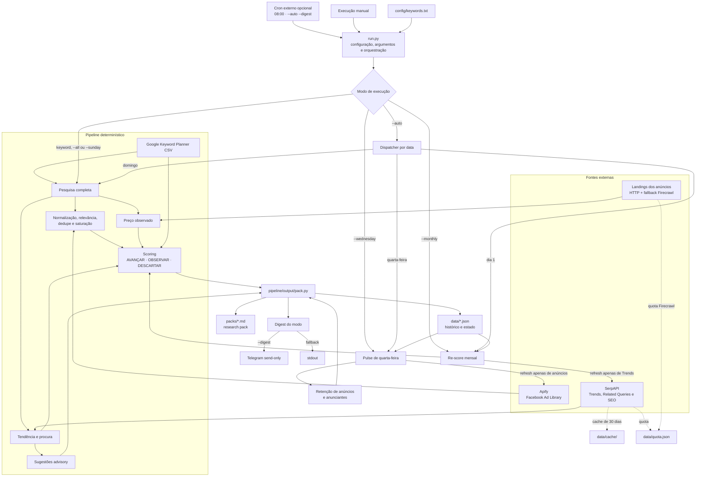

# ECOM-RESEARCH

CLI determinístico para transformar uma keyword num research pack. O pipeline usa anúncios ativos existentes como prova de procura; o score organiza sinais, mas não escolhe produto, país ou campanha. Qualquer sugestão é advisory e precisa de aprovação manual.

## Setup

```bash
python3 -m venv .venv
source .venv/bin/activate
pip install -r requirements.txt
cp .env.example .env
```

O modo full requer `APIFY_API_TOKEN` e `SERPAPI_KEY`. O repositório não contém credenciais Telegram localmente e o `.env` está ignorado pelo Git. Não alteres `config/keywords.txt` para aceitar sugestões: elas aparecem no pack e no digest com `status: proposed`.

- `APIFY_API_TOKEN`: token do Apify para `curious_coder~facebook-ads-library-scraper`.
- `SERPAPI_KEY`: Trends e snapshot SEO.
- `FIRECRAWL_KEY`: fallback opcional para landings sem preço no HTML.
- `TELEGRAM_BOT_TOKEN` e `TELEGRAM_CHAT_ID`: entrega opcional, sempre send-only.

O volume e CPC vêm de um export CSV manual do Google Keyword Planner colocado em `data/`. Sem CSV, o pipeline degrada graciosamente, mas o score perde esse sinal.

## Uso

```bash
.venv/bin/python run.py "mochila personalizada"
.venv/bin/python run.py --all
.venv/bin/python run.py --sunday
.venv/bin/python run.py --wednesday
.venv/bin/python run.py --monthly
.venv/bin/python run.py --auto --digest
```

`--sunday` lê as keywords ativas sem as reescrever. `--auto` executa todas as ações que coincidirem com a data: no dia 1 executa primeiro o re-score mensal; depois executa domingo ou quarta-feira quando aplicável. Cada ação produz o seu próprio digest.

A precedência de selectores é fixa: `auto > sunday > wednesday > monthly > all > keyword`, com `--digest` ortogonal. Selectores sombreados (ex.: `--sunday --monthly`) geram avisos determinísticos no stderr, sem transformar comandos legados em erros. `--csv` com um caminho inexistente é erro fatal apenas nos modos que consomem CSV (keyword, `--all`, `--sunday`, e `--auto` quando dispara o domingo); nos restantes é ignorado com aviso.

## Arquitetura



`run.py` é o único orquestrador. O modo completo recolhe todos os sinais; quarta-feira reutiliza o último pack e atualiza apenas anúncios; o mensal reutiliza o último `OBSERVAR` e força apenas Trends. O JSON produzido funciona simultaneamente como output e estado histórico para os modos incrementais.

## Idempotência e proveniência

Cada ação lógica (domingo, quarta, dia 1, `--all`, keyword) tem um `run_id` determinístico derivado de data + modo + keywords ordenadas + `SCORING_VERSION` — sem credenciais, relógio ou `--digest`. O hash do CSV participa da identidade apenas nas ações que consomem o CSV (keyword, `--all`, `--sunday` — incluindo domingo via `--auto`), para que quarta e mensal permaneçam estáveis quando ficheiros CSV não relacionados mudam. Um run concluído reutiliza o digest e os artefactos persistidos em `data/runs/` sem voltar a gastar fontes pagas. `--auto` e a invocação direta do mesmo modo partilham a mesma identidade de run. Um run feito sem `--digest` permite um `--digest` posterior sem rerun de pesquisa.

Domingo e `--all` gravam o manifesto atomicamente após cada keyword (checkpoint por keyword). Um rerun de um manifesto `running`/`failed`/`completed_with_errors` reutiliza os resultados terminais (zero chamadas pagas para keywords já bem-sucedidas) e repete apenas as keywords com falha técnica ou ausentes do checkpoint. Um run só fica `completed` quando todas as keywords atingem um desfecho intencional; uma exceção técnica (não uma falha de fonte esperada) deixa o run `completed_with_errors`. Nesse caso o digest parcial nunca vai para o Telegram — o conteúdo mudaria após o retry e o operador receberia dois digests diferentes: é impresso no stdout e persistido com `delivery.status == "deferred"`, e o digest final é entregue exatamente uma vez depois de as keywords falhadas conseguirem. Falhas de fonte esperadas (Apify offline → pack `DADOS INSUFICIENTES`; quarta/mensal preservado) continuam terminais e digestáveis. Exactly-once ao nível da fonte não é garantido entre crashes (janela entre a chamada paga e a escrita do manifesto).

Os locks de run (um por `run_id`) e de quota (`data/quota.json.lock`) são bloqueantes e fail-closed: um segundo processo bloqueia até o primeiro terminar e o código nunca prossegue sem lock (fcntl indisponível ou lock inutilizável → erro). Tradeoff operacional aceite: o lock de quota é segurado durante a chamada ao provider inteira, o que serializa pedidos entre processos — risco residual de latência/concorrência — em troca de limites duros e contabilidade atómicos entre processos.

O JSON do pack ganha metadados aditivos: `run_id`, `mode`, `generated_at`/`completed_at`, `scoring_version`, `scoring_config`, `source_states` e `source_policies`. As chaves antigas (`keyword`, `date`, `score`, `trends`, `keyword_planner`, `facebook_ads`, `seo`, `suggested_keywords`, `ad_cohort`) permanecem como aliases. O Markdown ganha uma secção concisa **Proveniência** sem alterar o conteúdo das recomendações. Os estados de fonte são `valid` (um zero-ads Apify conta como leitura válida, e um run zero-ads regista Trends como `related_queries_only` mesmo quando a lista vem vazia), `stale` (evidência reutilizada de quarta/mensal), `missing` (não aplicável ou não tentado) e `failed` (erro de request/parse). As políticas de fonte (TTL, quota, timeout, retries=0, fallback) são persistidas sem segredos.

No dia 1, se o Trends falhar para uma keyword, o pack anterior é preservado: não é escrito nenhum pack de substituição, a falha aparece no digest e no run state, e a keyword permanece na watchlist OBSERVAR. Payloads de erro do Trends nunca são cacheados; entradas de erro legadas são tratadas como miss e removidas.

## Facebook Ad Library via Apify

Cada keyword faz uma única chamada POST, com custo do actor limitado a uma invocação e sample de 100, com timeout de conexão/leitura `(10, 135)`, `count=100` e uma URL global da Ad Library com `active_status=active`, `ad_type=all`, `country=ALL`, `is_targeted_country=false`, `media_type=all`, `search_type=keyword_unordered` e `q` URL-encoded. Não há retries.

A resposta é normalizada localmente com filtros determinísticos: status inativo é removido, texto é accent-folded, uma keyword exige o token e queries com vários tokens exigem pelo menos 60% de cobertura, com a frase exata sempre aceite. Duplicados são removidos por `ad_archive_id`, depois URL, depois `page_id + copy + date`. O pack guarda amostra, descartes, duplicados, IDs, top ads, advertisers e saturação; o limite de 100 permite que `alta` (>50) seja atingível.

Um resultado vazio é sucesso e força `DESCARTAR`, sem SEO nem landing. Ainda faz uma call Related Queries da SerpAPI, cacheada por 30 dias e contada na quota, para propor alternativas. Uma falha do Apify continua Trends, SEO e CSV, mas produz `DADOS INSUFICIENTES` e nunca um `DESCARTAR` falso.

## Custos e modos

| Modo | Apify | SerpAPI | SEO/landing | Dados usados |
|---|---:|---:|---|---|
| Full / domingo | 1 por keyword | Timeseries + related, salvo cache | Ambos, exceto falha Apify ou zero ads | Fresh |
| Quarta | 1 chamada paga/bounded por keyword elegível | 0 | 0 | Trends, CSV, SEO, landing, sugestões e score anteriores |
| Dia 1 | 0 | 1 timeseries forçada por keyword | 0 | Ads, CSV, SEO, landing e sugestões anteriores |

A quarta compara `ad_ids` e advertisers, mas se o Apify falhar relata o erro e preserva o último pack bom. O mensal é um caminho de rescore separado: não faz refresh de anúncios nem chama Firecrawl.

## Sugestões e mercados

`pipeline/suggestions.py` normaliza resultados Related Queries numéricos e `Breakout`, ordena Breakout primeiro e depois valores numéricos descendentes, remove vazios, a keyword original, duplicados, URLs e interrogativas. O JSON guarda `suggested_keywords`; o Markdown usa a secção **Sugestões de keywords — aprovação manual** e declara que nada foi adicionado a `config/keywords.txt`.

A secção **Sinais por mercado — decisão manual** lista PT, ES, FR e os top geos de Trends com `country`, `Trends demand`, `advertisers observed` e `ads observed`. Não existe ranking automático de país. O digest diz `Mercado: decisão manual`.

## Landings e Telegram

Preços usam exclusivamente `top_ads[].landing_url`; links da Ad Library são rejeitados. São tentadas no máximo três landings, primeiro por HTTP e depois por Firecrawl, com falhas isoladas e sem retries. Quarta e mensal reutilizam o resultado anterior.

Telegram é send-only: cada mensagem é plain text, no máximo 4000 caracteres, dividida em quebras de linha quando possível. O payload contém apenas `chat_id`, `text` e `disable_web_page_preview=true`. Falta de credenciais, timeout, HTTP diferente de 200, JSON inválido ou `ok != true` imprime o digest completo no stdout e não interrompe o pipeline. O token nunca é escrito em logs.

O progresso de entrega é persistido em `data/digests/<run_id>.json`: texto, hash, chunks enviados e um estado sanitizado (credenciais em falta, timeout, HTTP/JSON/API, sucesso, parcial). Num rerun, chunks registados como enviados nunca são reenviados; apenas os não enviados são retomados. Cada chunk bem-sucedido é persistido imediatamente. O token nunca é persistido. Um estado existente que seja ilegível, de outro conteúdo (hash/texto divergente) ou com chunks inconsistentes é fail-closed: nada é enviado, o caller devolve um erro sanitizado `state_corrupt` e imprime o digest no stdout, e o ficheiro suspeito nunca é sobrescrito (evita aceitar duas vezes o mesmo chunk). Janela de crash aceite: entre o Telegram aceitar um chunk e a persistência local, um crash pode duplicar esse chunk.

## Saída

- `packs/YYYY-MM-DD--<modo>--<kw_hash12>--<keyword>--<run_id[:12]>.md` / `data/YYYY-MM-DD--<modo>--<kw_hash12>--<keyword>--<run_id[:12]>.json`: todos os packs atuais são run-scoped — o nome inclui o modo (keyword/all/sunday/wednesday/monthly), um hash estável de 12 hex da keyword (evita colisões entre `a/b` e `a-b`) e o prefixo do `run_id` (o mesmo run repetido resolve para o mesmo caminho). Ex.: `2026-08-09--sunday--9f3a2b1c0d4e--mochila-personalizada--abc123def456`.
- Nomes legados `YYYY-MM-DD--<keyword>.md` / `.json` (e `--wednesday`/`--monthly`) continuam a ser lidos pelos selectors (compatibilidade read-only), mas já não são escritos.
- `data/runs/<run_id>.json`: manifesto de cada ação lógica (idempotência, checkpoints por keyword e estado de entrega do digest).
- `data/digests/<run_id>.json`: estado de entrega Telegram por run.
- `data/cache/`: cache de Trends/SEO/Related Queries por 30 dias (payloads de erro nunca são cacheados; entradas corrompidas ou com forma inválida são tratadas como miss).
- `data/quota.json`: contador SerpAPI e créditos Firecrawl (escritas atómicas).

As recomendações são operacionais, não decisões automáticas: `AVANÇAR` prepara o ad-machine após aprovação manual, `OBSERVAR` mantém watchlist/recheck, `DESCARTAR` arquiva salvo nova evidência e `DADOS INSUFICIENTES` pede retry do Apify.

## Verificação

```bash
.venv/bin/python -m pytest tests/ -q
.venv/bin/python -m compileall run.py pipeline
.venv/bin/python run.py --help
git diff --check
```

Todos os testes mockam rede; não são feitas chamadas reais durante a verificação. O último baseline é de **289 testes verdes**.

## Ativação live

O código não instala cron automaticamente. Antes de ativar:

1. Configurar e testar `TELEGRAM_BOT_TOKEN` e `TELEGRAM_CHAT_ID`.
2. Validar o CSV real do Keyword Planner.
3. Executar uma única keyword live e rever manualmente o Markdown/JSON, incluindo relevância, dedupe, custo Apify, landing e sugestões.
4. Regenerar antes de produção qualquer credencial que tenha sido partilhada numa conversa.
5. Só então instalar o cron diário das 08:00:

```cron
0 8 * * * cd /home/vitor/projects/Ecom-Research && /home/vitor/projects/Ecom-Research/.venv/bin/python run.py --auto --digest >> /home/vitor/projects/Ecom-Research/data/cron.log 2>&1
```

O cron verifica a data diariamente, mas só atua ao domingo, à quarta-feira e no dia 1 do mês.
